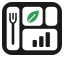

# Tray Return Tracker

Our Y4E Hackathon project. It's a station that sits at the cafeteria tray return and shows the kitchen which foods keep getting thrown away, so they know what to change.

It tracks food, not students. No names or student IDs are ever saved.

## How it works

1. A student drops off their tray at the return.
2. The camera takes a photo and the scale weighs what's left.
3. The app works out how much of each food is still on the tray.
4. The student can tap why they left food: too much, didn't like it, too cold, or loved it.
5. The dashboard adds it all up and suggests changes, like smaller portions or a share table for fruit.

## Running it

**On a Mac:** double-click **Open Food Waste App.command**. It starts a small local server and opens the start page at http://localhost:8100. Click **Open the app** for the station and dashboard, and keep the Terminal window open while you use it.

The first time, macOS might say the file is from an "unidentified developer." Right-click it, choose **Open**, then click **Open** again.

**In VS Code:** open this folder and press **Cmd+Shift+B** to run the **Start food waste app** task.

**From a fresh clone:** you need Python 3 and Node. The launcher and the VS Code task run `npm install` the first time to grab anime.js.

Always open it through localhost. The camera and the start page animations don't work if you just double-click an HTML file.

## Using the app

- **Station:** pick the day, hold the tray up to the camera, and press **Scan tray**. If there's food left, the student can vote. The camera stays on in the corner, so you can go straight to the next tray.
- **Use a photo:** pick a picture of a tray instead of using the camera. A top-down phone photo works best.
- **Photo recognition:** paste a free [Groq](https://console.groq.com/keys) or [Gemini](https://aistudio.google.com/apikey) API key in **Settings**. The app tells which one it is from the key. The key is saved only in your browser, never in the code. Without a key, switch to **Demo mode**, which makes up realistic results.
- **Real scale:** weigh the tray on any kitchen scale and type the number into **Real scale reading** before you scan. The results get adjusted to match the real weight.
- **Menu:** each day has categories (Main, Veg main, Side, Fruit, Drink), and each category can have more than one food. You can add your own categories and change serving sizes.
- **Dashboard:** waste by food, why students left food, waste per day, suggestions for the kitchen, and **Export CSV**. Filter by 7 days, 4 weeks, or all time.
- **Lunch rush** adds 50 made-up trays at once, which is handy for demos.
- Everything is saved in your browser. **Settings > Reload 4 weeks of sample data** resets the demo.

## What's in here

| Folder | What it is |
|---|---|
| `food-waste-app/` | The website. `index.html`, `start.css` and `start.js` are the start page. `app.html`, `app.css` and `app.js` are the app. `server.py` serves it locally. |
| `food-waste-app/img/` | Pictures for the start page |
| `food-waste-station/` | Python version for a Raspberry Pi with a real load cell, camera and vote buttons. See its own README. |
| `design-system/` | Design notes and the Blender files for the start page scenes |
| `logistics-hero/` | A separate freight train page, not part of the app |
